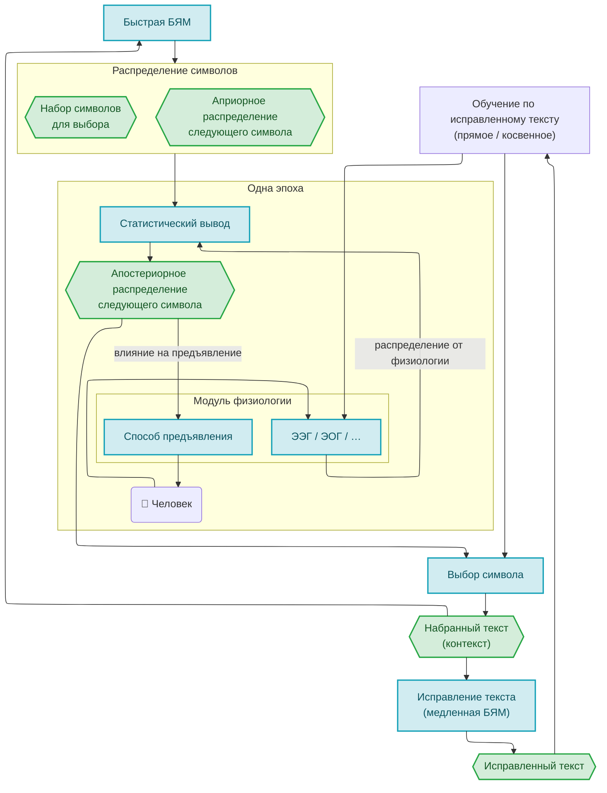
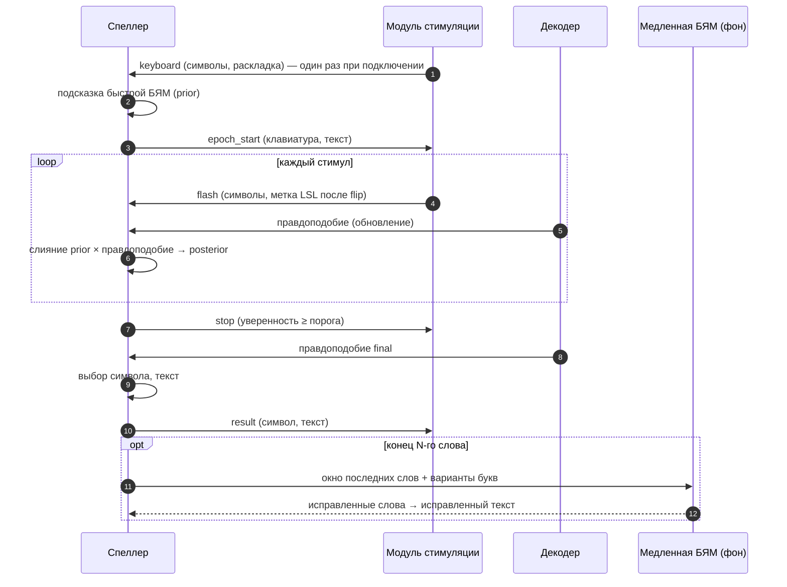

# Архитектура

Спеллер состоит из нескольких процессов, которые общаются через LSL, и ядра на Python со сменными частями.

## Общая схема

Как данные проходят через спеллер: быстрая БЯМ даёт априорное распределение, внутри эпохи модуль физиологии показывает стимулы и присылает распределение по ЭЭГ, статистический вывод объединяет их, детектор выбирает символ, медленная БЯМ исправляет набранный текст. Обучение по исправленному тексту заложено в схему и пока не используется. Исходная схема (английские подписи) — [в редакторе mermaid.live](https://mermaid.live/edit#pako:eNqVVd1u6jgQfpWRqyNRCTgk_EfqSl3g7KlUVNRwtc3RyiQTsJrYkeOo5VAeYZ9hL_f19hHWdggEyl4sEgjbM99834xnvCOhiJB4pNVqBTLgoeAxW3vmL0CciLdwQ6U6rAEijGmRqGfkEUqUHgQEk9eAmHPzPaAcHWH5a3Vk3L98gbu7O5hTxi04NBKMFSgBkq036tacVraL5W4XkIVkKZVbWOK7gkYmMcSI8TVonkpv3QZkv_c8L6KKVo7f_PlLQHxRyBBhrtUl0PhGcwWPj3Nt_0ObG82nONBq_WK86kzzYrWWNNuAv01XU5YrCQZUL0QCds1WhWKCa8DKx3yefd_QfsYMpRJMIogYcuuWQywk5JhgWDp-Ym4-9ws5NQj3kEkmJIOoFsyAcZOJEvEKhC5MLQ9W2VHBVX1PMyPsiSPMMhFuLuREWoFle1HIM4jF3EAsNtuciUSstybpRYIXUDbX8z9SVBsRGXuJOXJFLfrc7n4uTs0xtwXVjrPZb_AVZk_mt91uX3c65KG-9b1IKW8E5J-__v4TvotUgE8zhjzUTG_rhv6DKbVhlisW0gQeeKxvuzW8Fut-IaqSiVzh_y1bHUo3yIO-2JLrqGWDKJGZ_lgJpUR6RvOYTFtlq-6TXHt0TN6Fd7lpTD4CUr_TEEuRwqmgAfnQSTlPkUU2yi8zccDTOUsKkzPQeFm91umh1h8nBRe399ia_vTlNAKq5kOlr6SQ57WoTZiJ4Ly8tDmsUL0hclglInzNK6NTT9v-OCqr6JvANQ7l1vKM2XJimOlyt2IaqiItB9REyKpfGr4p3_WR49vR5qMeYpFR1jj4YXRrca709WFK6bg1CiX9M2LPj2-T5cvUtu1XZqd0qPQuFHk5Ng-BwEzPHydCFso6nyHp7WsXqH5WpurKlPfVNjExazM9TGieTzEGIw1iliTeTdTDKKJNXQ3xit6NO6LDXv-wbL2xSG08N3tvhvomSu_G6feHbu8TnsluhedgGDtHPGdI3dXoP_E6Yb836JAmWUsWEU_JApskRZlSsyQ7EycgaoOpbn7z3EmMiveW9dbPHt9r14zy34VIK28pivWGeDFNcr0qMq0Vp4zqWXkyse_nRBRcEa_rdkcWhHg78k4813Hanb4zdvodZzx2u4Mm2RKv1Rt12oOB4w6G457bHbvucN8kP21cpz3ojdzOYDhwO25v2Ol0m0Q_k7pJ5uXjbt_4_b_tzoQO).



## Процессы

| Процесс | Что делает | Как запускается |
|---|---|---|
| **Спеллер и окно оператора** | цикл эпох, языковые модели, слияние, решение, запись сессии; веб-окно оператора на 127.0.0.1 | `python -m eeg_speller.external.server` |
| **Модуль стимуляции** | объявляет свою клавиатуру, рисует экран испытуемого и шлёт метки стимулов; может сам декодировать ЭЭГ. Все параметры — в его `settings.json` | окно оператора запускает выбранный модуль из `stimulus_kit/modules/` без аргументов (или вручную) |
| **Декодер ЭЭГ** | присылает правдоподобие символов | отдельно, например `stimulus_kit/decoders/p300_lsl_decoder.py`, или внутри модуля стимуляции |
| **Источник ЭЭГ** | поток отсчётов в LSL | усилитель / его мост в LSL / `stimulus_kit/tools/edf_to_lsl.py` |

LSL-потоки протокола `speller-link@1`: `SpellerControl` (спеллер → модули), `SpellerStimuli` (метки стимулов), `SpellerLikelihood` (правдоподобие). Описание — [`stimulus_kit/CONTRACT.md`](../stimulus_kit/CONTRACT.md).

## Эпоха (набор одного символа)



- **Окончание эпохи.** Решение принимается по оценке с `final=true`. Если её нет, решение принимается по последней оценке через заданное время после `stop` или после `done` модуля. Если не пришло ни одной оценки, эпоха прерывается и повторяется.
- **Фоновая коррекция.** Медленная БЯМ работает в фоновом потоке и не задерживает следующую эпоху.

## Сменные части ядра

| Часть | Где | Как заменить |
|---|---|---|
| Клавиатура | модуль стимуляции; проверка и перевод в `core/keyboard.py` | модуль объявляет её в `SpellerLink(keyboard=…, layout=…)`; символы приводятся к алфавиту БЯМ (заглавные → строчные, Ё → е, `_` → пробел). Без объявления — клавиатура профиля |
| Быстрая БЯМ | `llm/fast.py`, `llm/backends/` | `ngram` (файл в `models/ngram`), `kenlm` (имя на Hugging Face или путь), `hf_causal` (имя модели), `mock_ngram` |
| Статистический вывод | `inference/*.py`, загрузчик `epoch/plugins.py` | новый файл с `PARAMS` и `combine(prior, likelihood, params)` |
| Медленная БЯМ | `llm/slow.py`, `llm/backends/chat_api.py`, `llm/word_candidates.py` (словарь по вариантам букв), `mock_correction.py` | провайдер и модель в окне оператора; выбор облачного провайдера разрешает отправку ему последних слов; промпт — редактор в окне или `prompts/correction_v3.txt` (похожие слова из `llm/word_candidates.py`) |
| Модуль стимуляции | `stimulus_kit/modules/` | новая папка с `main.py` и `settings.json` |
| Декодер | отдельный процесс | любой, кто шлёт `SpellerLikelihood` |

Интерфейс быстрой модели:

```python
class FastLanguageModel(Protocol):
    model_id: str
    def predict(self, context: str, repertoire: Repertoire) -> SymbolDistribution: ...   # log P(символ)
    def top_words(self, context: str, n: int) -> list[tuple[str, float]]: ...
```

Интерфейс медленной модели: `correct(left_context: str, window: list[str], letters=None) -> list[str]`. Ответ подгоняется к окну (`slow.align_correction`, MA-38): слово заменяется только словом той же длины; если число слов не совпало, слова сопоставляются по порядку, а ответ отклоняется, только если не подошло ни одно.

## Слияние и решение

- **Слияние.** Модуль `inference/` получает логарифмы prior и правдоподобия по символам клавиатуры и возвращает логарифмы апостериорных вероятностей. По умолчанию это `log_pool`: `α·log prior + β·log правдоподобие` (при α = β = 1 — формула Байеса).
- **Без БЯМ.** Апостериорное распределение равно правдоподобию.
- **Решение.** Выбирается символ с максимальной апостериорной вероятностью. Если она ниже `detector.tau`, у решения ставится флаг «неуверен».
- **Досрочная остановка.** `stop` посылается, когда максимум апостериорной вероятности ≥ `external.stop_confidence` и обновлений не меньше `min_updates_before_stop`.

## Время

- **Метки LSL.** Каждое событие сессии получает `lsl_s` — время по часам LSL этого компьютера. Это те же часы, в которых приходят метки стимулов и отсчёты ЭЭГ.
- **Монотонные часы.** Кроме того, у события есть `t_ns` (монотонные часы процесса) и сквозной номер `seq`.
- **Метки стимулов** ставит модуль после `flip`; LSL переводит их в часы приёмника.
- **Ожидание подключения.** `SpellerLink` при старте ждёт, пока спеллер подключится к потокам модуля, поэтому первые метки не теряются.

## Режимы без окна оператора

| Режим | Что это | Команда |
|---|---|---|
| симуляция | виртуальный участник и симулированная ЭЭГ с заданным качеством сигнала (`physiology.sim.d_prime`), виртуальное время | `python -m eeg_speller run`, `experiment` |
| переигрывание | стимулы и правдоподобие ЭЭГ эпохи k берутся из эпохи k записанной сессии (на той клавиатуре, что объявил модуль) и проигрываются тому же контроллеру, что в живой сессии; языковая часть, слияние, досрочная остановка и решение пересчитываются. Более ранний стоп учитывается: полученные к нему данные становятся окончательными | `python -m eeg_speller replay <сессия> [--config изменения.yaml] [--llm off]` (`recording/replay_external.py`) |

## Пакет `eeg_speller`

```
external/     server.py (окно оператора, API), controller.py (эпохи со сменными модулями),
              transport.py (LSL), launcher.py (поиск и запуск модулей), tasks.py, static/
core/         config.py, keyboard.py, distributions.py, clock.py, events.py
llm/          fast.py, slow.py, char_marginal.py
  backends/   char_ngram.py, kenlm_words.py, hf_causal.py, mock_ngram.py, chat_api.py, mock_correction.py
epoch/        plugins.py (статистический вывод), loop.py и fusion.py (симуляция), presentation_feedback.py
decoding/     detector.py
text/         primary.py, secondary.py, normalize.py
recording/    recorder.py, storage.py, export.py, replay.py (симуляция), replay_external.py (окно оператора)
physiology/   base.py (типы), simulated.py, p300.py, sources.py, edf_demo.py, calibrate.py, stimuli.py
evaluation/   metrics.py, stats.py, experiment.py, bench.py
ext/          word_prediction.py, ui_console.py, tts.py, commands.py
learning/     rl_block.py, calibration.py (псевдометки по исправлениям; офлайн-калибровка)
```

Проектные допущения (MA-NN) и открытые вопросы (Q-NN), на которые ссылаются комментарии в коде, собраны в [`docs/research/`](research/).
