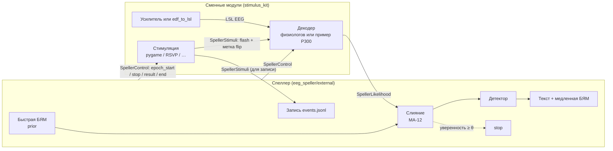

# Съёмные модули стимуляции и декодирования

Ветка `external-stimulus`, 14.10.2026. Основа — `main` от 13.10.2026 (физиология EDF/LSL Марка).
Инструкция для физиологов — [`stimulus_kit/README.md`](../stimulus_kit/README.md). Решения: MA-34, Q-35…Q-37.

## Зачем

Правки руководителя по версии от 13.10:

| Правка | Как сделано здесь |
|---|---|
| Погрешность синхронизации < 5 мс | Метку вспышки ставит программа, которая рисует, в момент `flip`, в часах LSL. LSL переносит метку вместе со временем и пересчитывает в часы приёмника. Задержка сети и наших потоков на метку не влияет. На одном компьютере расхождение между отправленной и записанной меткой — менее 1 мс (тест `test_lsl_end_to_end_and_marker_timing`). Постоянная задержка монитора — Q-37, измеряется фотодиодом. Для сравнения: в `main` время кадра бралось из браузера, расхождение до 8,4 мс. |
| LSL | Весь обмен — три LSL-потока маркеров (`SpellerControl`, `SpellerStimuli`, `SpellerLikelihood`). ЭЭГ — любой LSL-поток. |
| EDF только передаётся, спеллер его не открывает | `stimulus_kit/tools/edf_to_lsl.py` проигрывает EDF в LSL как живой усилитель. Код спеллера (`eeg_speller/external/`) не импортирует `pyedflib` и не читает файлы ЭЭГ. |
| Основная программа не знает, что на экране испытуемого | Спеллер шлёт только «выбери символ из этих 36» и получает вероятности. Порядок, форма и число вспышек — дело модуля. Окна участника в браузере в этом режиме нет. |
| Переход между эпохами (показать символ) | После решения спеллер шлёт `result` (символ и текст), затем ждёт `stimulus.pause_ms`. Что показать испытуемому — решает модуль; примеры показывают выбранную букву. |
| Упростить окно оператора | Новое окно `python -m eeg_speller.external.server`: старт сессии, набранный текст с заданием, текущий лидер и шкала уверенности, итоги, пауза/завершение. Всё остальное — в свёрнутом блоке «Подробнее». |
| Съёмный модуль с минимальными правилами | Одно правило: `link.flash(symbols)` после `flip`. Файл-помощник `speller_link.py` зависит только от `pylsl`. Модули на других языках — через JSON в LSL. |
| Сигнал завершения демонстрации | `stop` при уверенности ≥ порога (MA-34). Модуль может его игнорировать. |

## Как это устроено



Цикл одной эпохи:
1. Спеллер считает prior быстрой БЯМ и шлёт `epoch_start` (36 символов, раскладка, набранный текст, рекомендуемые тайминги). Текст задания модулям не передаётся.
2. Модуль показывает вспышки и после каждого `flip` шлёт `flash`. Спеллер только записывает их.
3. Декодер шлёт вероятности (после каждой вспышки или один раз). Спеллер сливает каждое обновление с prior.
4. Если уверенность ≥ `stop_confidence` и обновлений ≥ `min_updates_before_stop` — спеллер шлёт `stop`.
5. Решение принимается по `final=true`, иначе по последней оценке после `stop_grace_s` (после `stop`) или `decode_wait_s` (после `done`). Без единой оценки эпоха прерывается и повторяется.
6. Спеллер шлёт `result`, обновляет текст, вызывает медленную БЯМ на конце слова, ждёт `pause_ms`.

Модули могут появляться и исчезать во время сессии: спеллер ищет потоки непрерывно. Ответы декодера для следующей эпохи, пришедшие раньше времени (например, при проигрывании EDF), буферизуются.

## Запуск

```powershell
uv pip install -e ".[test,eeg,external]"
uv run --no-sync python -m eeg_speller.external.server          # окно оператора: http://127.0.0.1:8770/
uv run --no-sync python stimulus_kit/examples/pygame_matrix.py --keyboard
```

Проверка без экрана и без ЭЭГ, одной командой:

```powershell
uv run --no-sync python scripts/run_external_demo.py sim --text "привет"
```

EDF через LSL с примером P300-декодера:

```powershell
uv run --no-sync python -m eeg_speller.physiology.edf_demo --text "привет"
uv run --no-sync python scripts/run_external_demo.py edf
```

Профили: `ext_default.yaml` (с БЯМ, стоп при 0,99), `ext_no_llm.yaml` (без БЯМ), `ext_no_stop.yaml` (без сигнала остановки).

## Что проверено (14.10.2026, Linux, Python 3.13, liblsl 1.18)

| Проверка | Результат |
|---|---|
| Все тесты (`pytest`) | 39 passed (30 прежних + 9 новых) |
| Метки вспышек через LSL, один компьютер | расхождение отправленной и записанной метки < 1 мс |
| EDF «привет» → `edf_to_lsl` → `p300_lsl_decoder` → спеллер (без БЯМ и с БЯМ) | набрано «привет», 6 из 6 |
| `pygame_matrix --keyboard`, `pygame_rsvp --keyboard` без дисплея (SDL dummy) | работают, эпохи завершаются, результат показывается |
| Окно оператора в headless Chromium | старт, ход сессии, завершение |
| Симуляция d′ = 1, 5 повторений, «привет, как у тебя дела.» | без стопа ~63 % точности, 60 вспышек; стоп 0,95 — 50 % и 39 вспышек; стоп 0,99 — 75 % и 57 вспышек. Одиночные прогоны, разброс большой |

Не проверено: реальный монитор и фотодиод, реальный усилитель, два компьютера в сети, программы физиологов.

## Ограничения и открытые вопросы

- **Задержка монитора (Q-37).** Метка соответствует возврату из `flip`. Реальное свечение позже на постоянную величину. Без фотодиода гарантировать < 5 мс от свечения нельзя.
- **Порог остановки (MA-34, Q-36).** С переуверенным prior или декодером ранняя остановка ухудшает точность. Порог 0,99 — временный, нужен EXP-05.
- **Несколько спеллеров в одной сети.** Модуль подключается к первому найденному `SpellerControl`. Для нескольких стендов в одной сети нужен фильтр по имени стенда или отдельная конфигурация LSL.
- **Нумерация эпох в EDF.** `edf_to_lsl` воспроизводит эпохи по записи. Если спеллер повторяет эпоху (отказ), нумерация расходится.
- **Сырой сигнал не пишется спеллером.** Для полной записи эксперимента нужен LabRecorder (XDF со всеми потоками `Speller*` и ЭЭГ) или запись на стороне физиологов.
- **Старый браузерный режим не тронут.** `python -m eeg_speller.web.server` работает как в `main`.
